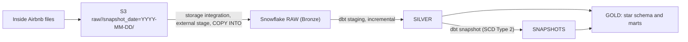
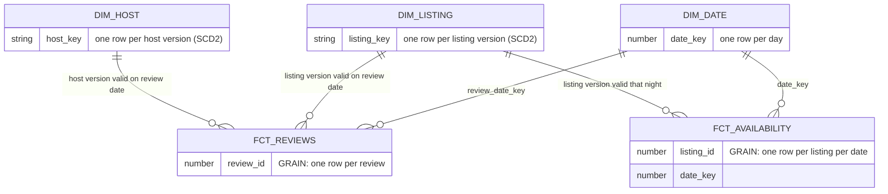
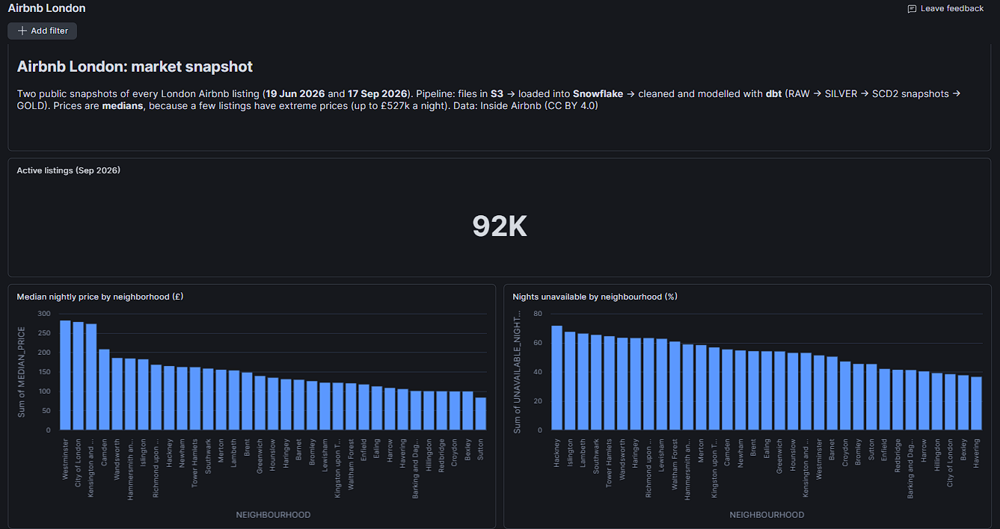
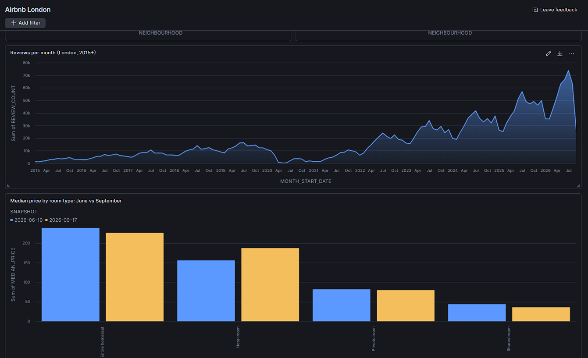

# Airbnb End-to-End ELT Pipeline

[](https://github.com/twarangupta/airbnb-elt/actions/workflows/ci.yml)

A batch ELT pipeline that loads Inside Airbnb listings, hosts, calendar and review data from AWS S3 into Snowflake, transforms it with dbt into Bronze, Silver and Gold layers and a star schema, keeps SCD Type 2 history of hosts and listings with dbt snapshots, and builds marts for price, availability and reviews per neighbourhood.

Status: work in progress. Phase 5 and the Snowsight dashboard done: Gold star schema (3 dimensions, 2 facts) and 5 marts, built and tested in 35 s on an X-SMALL warehouse (36 tests). Every one of 2,478,791 reviews reaches the fact table; 2,286,305 of them predate the first snapshot and join to the listing version through a 1900-01-01 valid_from rule. Earlier phases: SCD Type 2 history (47,154 listings and 6,041 hosts changed between 2026-06-19 and 2026-09-17), incremental Silver, and 72,185,440 RAW rows reconciled against landing counts.

## Architecture



## Star schema (Gold)



Facts join to the dimension version valid on the event date (point-in-time). Each key's first version starts at 1900-01-01 so events older than the first snapshot still join; unmatched facts go to an "unknown" member, and a test checks no review is lost. `fct_availability.nightly_price` comes from the listing version, because Inside Airbnb's calendar has no price.

Marts: `mart_listing_reviews_monthly` (listing x month), `mart_neighbourhood_summary` (median price, unavailability rate, listings, reviews, rating per neighbourhood), and small dashboard marts `mart_reviews_monthly`, `mart_price_by_room_type`, `mart_scd_changes`. Prices use medians (outliers up to 527,524 a night); "unavailability rate" counts booked and host-blocked nights, so it is a demand proxy, not occupancy.

## Dashboard (Snowsight)

A Snowsight dashboard on the Gold marts; every tile's SQL is in [`dashboards/snowsight/`](dashboards/snowsight/), and each tile reads a mart of 1 to 199 rows.





What it shows (London, 2026-09-17 unless noted):
- 91,954 active listings; city median price 175 a night (180 on 2026-06-19).
- Median price by neighbourhood from about 282 (Westminster) to about 85 (Sutton).
- Share of forward nights unavailable from about 72 percent (Hackney) to about 37 percent (Havering); unavailable includes host-blocked nights, so this is a demand proxy, not occupancy.
- Reviews per month from 2015: the April 2020 lockdown drop, then a peak of 73,835 in July 2026 (September 2026 is partial).
- Median price by room type, June vs September: entire home 239.50 to 227.00, hotel room 156.00 to 187.50, private room 82.27 to 80.00, shared room 44.00 to 36.00.
- SCD2 changes: 47,154 listings and 6,041 hosts changed between the snapshots; 1,492 hosts became superhosts.

Data: Inside Airbnb (CC BY 4.0).

## Stack

AWS S3, Snowflake, dbt Core (dbt-snowflake, dbt_utils), Python 3.11, Make, GitHub Actions.

## Repository layout

```
infra/aws/          IAM policy files and S3 setup steps
infra/snowflake/    Snowflake setup SQL (warehouse, database, schemas, role, service user)
ingestion/          landing script: Inside Airbnb to s3://.../raw/<city>/snapshot_date=YYYY-MM-DD/
tests/              Python unit tests (pytest)
dbt/                dbt project (models, snapshots, macros, tests)
scripts/            helper scripts (secret check)
.github/workflows/  CI: secret check, sqlfluff lint, dbt deps and parse
```

## Getting started

1. Create a Python 3.11 venv and install pinned packages: `make venv install` (installs `requirements-dev.txt`)
2. Copy `.env.example` to `.env` and fill in your own values (never commit `.env`).
3. Install dbt packages and validate the project: `make deps parse`
4. Run the same checks as CI: `make ci`
5. Land the raw files in S3 (needs AWS values in `.env`): `make land-old`
6. Snowflake setup: run `infra/snowflake/01_setup.sql` to `03_raw_tables.sql` (see comments in each), then load and reconcile: `make load-raw-old`
7. Build and test the Silver layer: `make silver` (check RAW age with `make freshness`)
8. Record SCD Type 2 history, one Inside Airbnb snapshot at a time, oldest first: `make snapshot SNAPSHOT_DATE=2026-06-19`, then land and load `2026-09-17` (`make land-new`, `make load-raw-new`, `make silver`) and `make snapshot SNAPSHOT_DATE=2026-09-17`
9. Build and test the Gold star schema and marts: `make gold`
10. AWS setup: see [infra/aws/README.md](infra/aws/README.md).

## Data and licence

Data: [Inside Airbnb](https://insideairbnb.com/get-the-data/) (London, snapshots 2026-06-19 and 2026-09-17), licensed under [CC BY 4.0](https://creativecommons.org/licenses/by/4.0/). Files are landed unchanged in a private S3 bucket and are not redistributed by this repository.

## Roadmap

- Phase 4 (done): SCD Type 2 snapshots of hosts and listings across two snapshots.
- Phase 5 (done): Gold star schema and marts, plus a Snowsight dashboard (screenshots above).
- After Phase 5: export the small Gold marts to `exports/gold/*.parquet` with a manifest (row counts, export time, source query), so results survive the Snowflake trial.
- Phase 6 and 7: orchestration, docs and lineage, CI, interview write-up.
- Final: a public Streamlit dashboard (separate repo) reading the exported files, with no warehouse credentials. Data: Inside Airbnb (CC BY 4.0).
