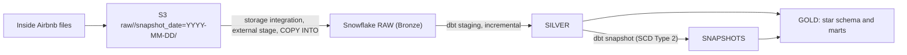

# Airbnb End-to-End ELT Pipeline

[](https://github.com/twarangupta/airbnb-elt/actions/workflows/ci.yml)

A batch ELT pipeline that loads Inside Airbnb listings, hosts, calendar and review data from AWS S3 into Snowflake, transforms it with dbt into Bronze, Silver and Gold layers and a star schema, keeps SCD Type 2 history of hosts and listings with dbt snapshots, and builds marts for price, availability and reviews per neighbourhood.

Status: work in progress. Phase 2 done: the 2026-06-19 London snapshot is loaded into Snowflake RAW (36,205,627 rows in 66 s on an X-SMALL warehouse), reconciled exactly against the row counts recorded at landing; a rerun skips every file.

## Architecture



## Stack

AWS S3, Snowflake, dbt Core (dbt-snowflake, dbt_utils), Python 3.11, Make, GitHub Actions.

## Repository layout

```
infra/aws/          IAM policy files and S3 setup steps
infra/snowflake/    Snowflake setup SQL (warehouse, database, schemas, role, service user)
ingestion/          landing script: Inside Airbnb to s3://.../raw/<city>/snapshot_date=YYYY-MM-DD/
tests/              Python unit tests (pytest)
dbt/                dbt project (models, snapshots, macros, tests)
scripts/            helper scripts (secret check)
.github/workflows/  CI: secret check, sqlfluff lint, dbt deps and parse
```

## Getting started

1. Create a Python 3.11 venv and install pinned packages: `make venv install` (installs `requirements-dev.txt`)
2. Copy `.env.example` to `.env` and fill in your own values (never commit `.env`).
3. Install dbt packages and validate the project: `make deps parse`
4. Run the same checks as CI: `make ci`
5. Land the raw files in S3 (needs AWS values in `.env`): `make land-old`
6. Snowflake setup: run `infra/snowflake/01_setup.sql` to `03_raw_tables.sql` (see comments in each), then load and reconcile: `make load-raw-old`
7. AWS setup: see [infra/aws/README.md](infra/aws/README.md).

## Data and licence

Data: [Inside Airbnb](https://insideairbnb.com/get-the-data/) (London, snapshots 2026-06-19 and 2026-09-17), licensed under [CC BY 4.0](https://creativecommons.org/licenses/by/4.0/). Files are landed unchanged in a private S3 bucket and are not redistributed by this repository.
