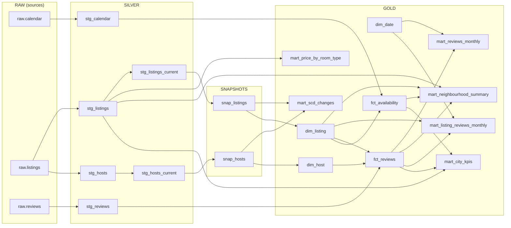
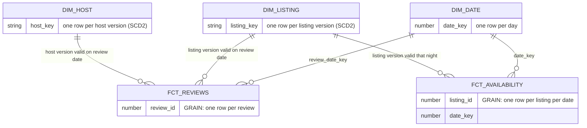
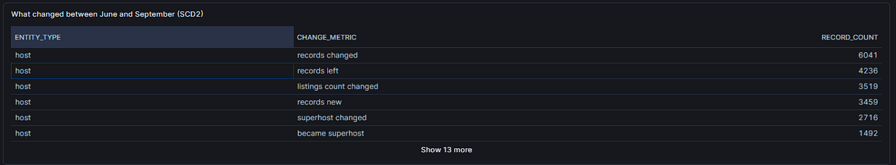

# Airbnb End-to-End ELT Pipeline

[](https://github.com/twarangupta/airbnb-elt/actions/workflows/ci.yml)

**Live dashboard:** [airbnb-london-elt.streamlit.app](https://airbnb-london-elt.streamlit.app/) (Streamlit, reads the exported Gold marts; no warehouse needed)

A batch ELT pipeline on public Inside Airbnb data for London. Raw files land unchanged in AWS S3, Snowflake loads them with `COPY INTO`, and dbt builds cleaned incremental Silver models, SCD Type 2 history of listings and hosts, and a Gold star schema with marts for price, availability and reviews per neighbourhood. Small Gold marts are exported to Parquet and served by a public Streamlit app, so the results stay online after the Snowflake trial ends (about 2026-12-12).

Built with two real quarterly snapshots (2026-06-19 and 2026-09-17): 72,185,440 RAW rows, every load reconciled against the row counts recorded at landing, and one command (`make run-all`) that rebuilds everything and changes nothing on a rerun.

## Architecture

```mermaid
flowchart LR
  IA["Inside Airbnb<br/>London CSV.gz<br/>(quarterly snapshots)"] -->|"ingestion/land_files.py<br/>download once, count rows, sha256"| S3[("AWS S3<br/>raw/london/snapshot_date=YYYY-MM-DD/")]
  S3 -->|"external stage + COPY INTO<br/>header guard, count reconciliation"| RAW["Snowflake RAW<br/>(Bronze, all text, append-only)"]
  RAW -->|"dbt: typed, deduplicated<br/>reviews + calendar incremental"| SIL["SILVER"]
  SIL -->|"dbt snapshot<br/>check strategy"| SNAP["SNAPSHOTS<br/>(SCD Type 2)"]
  SIL --> GOLD["GOLD<br/>star schema + marts"]
  SNAP --> GOLD
  GOLD --> SS["Snowsight dashboard"]
  GOLD -->|"scripts/export_gold.py"| PQ["exports/gold/*.parquet<br/>+ manifest.json"]
  PQ --> ST["Streamlit app<br/>(public, no credentials)"]
```



| Layer | What it holds | Tool |
|---|---|---|
| S3 `raw/` | the original files, byte for byte, one folder per snapshot | Python, boto3 |
| RAW | every CSV column as text plus `_source_file`, `_source_row`, `_snapshot_date`, `_loaded_at` | Snowflake stage + `COPY INTO` |
| SILVER | typed, cleaned, deduplicated: `stg_listings`, `stg_hosts` (tables), `stg_reviews`, `stg_calendar` (incremental merge) | dbt |
| SNAPSHOTS | SCD Type 2 history: `snap_listings`, `snap_hosts` | dbt snapshots |
| GOLD | `dim_date`, `dim_listing`, `dim_host`, `fct_reviews`, `fct_availability`, 6 marts | dbt |
| exports | 5 small marts as Parquet (27.8 KB in total) | Python, pyarrow |

## dbt lineage

Generated from dbt's own `manifest.json` (`make lineage`), so it always matches the project:



## Data model (Gold star schema)



- **Point-in-time joins:** facts join to the dimension version valid on the event date (`valid_from <= date < valid_to`).
- **1900-01-01 rule:** history starts at the first snapshot (2026-06-19) but reviews go back to 2009, so each key's first version is valid from 1900-01-01. 2,286,305 of 2,478,791 reviews depend on it; without it they would drop out of the join.
- **Unknown member:** facts whose listing is in no listings file (12 reviews, 2,555 calendar nights) point to an "unknown" row instead of being dropped; a test checks Gold has exactly as many reviews as Silver.
- **Price in `fct_availability`:** Inside Airbnb's calendar files have no price column, so the nightly price comes from the listing version valid on that night (66.8 percent of nights have one).
- **Marts:** `mart_listing_reviews_monthly` (996,958 rows), `mart_neighbourhood_summary` (33), `mart_city_kpis` (1), `mart_reviews_monthly` (199), `mart_price_by_room_type` (8), `mart_scd_changes` (19). Prices use medians (listed prices go up to 527,524 a night); "unavailability rate" counts booked and host-blocked nights, so it is a demand proxy, not occupancy.

## Dashboards

**Public:** [airbnb-london-elt.streamlit.app](https://airbnb-london-elt.streamlit.app/), code in `dashboards/streamlit/app.py`, reading `exports/gold/`.

**Snowsight** (inside the trial account; every tile's SQL is in [`dashboards/snowsight/`](dashboards/snowsight/)):




What the data shows (London, 2026-09-17 unless noted):
- 91,954 active listings; city median price 175 a night (180 on 2026-06-19).
- Median price by neighbourhood from 282 (Westminster) to about 85 (Sutton).
- Forward nights unavailable from about 72 percent (Hackney) to about 37 percent (Havering); city-wide 57.7 percent.
- Reviews per month: the April 2020 lockdown collapse, then a record 73,835 in July 2026 (September 2026 is a partial month).
- Median price by room type, June to September: entire home 239.50 to 227.00, hotel room 156.00 to 187.50, private room 82.27 to 80.00, shared room 44.00 to 36.00.
- Between the snapshots 47,154 listings and 6,041 hosts changed (price on 45,897 listings, 25,365 down and 14,075 up); 1,492 hosts became superhosts and 1,195 lost the status.

## How to run

Prerequisites: Python 3.11, GNU Make, an AWS bucket and IAM user (see [infra/aws/README.md](infra/aws/README.md)), a Snowflake account set up with `infra/snowflake/01_setup.sql` to `03_raw_tables.sql` (comments in each), and a `.env` copied from `.env.example`.

```bash
make venv install deps   # Python 3.11 venv, pinned packages, dbt packages
make ci                  # the same checks as GitHub Actions
make run-all             # the whole pipeline
```

`make run-all` (`scripts/run_pipeline.py`) runs, in order and stopping at the first failure:

1. land each snapshot in S3 (skips files already there)
2. `COPY INTO` RAW per snapshot (Snowflake load metadata skips loaded files; table counts reconciled with landing counts)
3. `dbt source freshness`
4. `dbt build` Silver (incremental models process only newly loaded rows)
5. `dbt snapshot` for snapshot dates newer than the history already recorded, oldest first (older dates are skipped so history is never written backwards)
6. `dbt build` Gold, including the "no review lost" test
7. export the small Gold marts to Parquet (written only if the data changed), then suspend the warehouse

Snapshot dates come from `SNAPSHOT_OLD` and `SNAPSHOT_NEW` in the Makefile (`make run-all SNAPSHOT_NEW=YYYY-MM-DD` to add a newer one). The date must be a published Inside Airbnb release for London: a date with no release fails at the landing step (HTTP 404) and nothing after it runs.

Single steps are also available: `make land`, `make load-raw`, `make silver`, `make snapshot SNAPSHOT_DATE=...`, `make gold`, `make export-gold`, `make docs`, `make lineage` (`make help` lists all).

## Tests and CI

- **dbt:** 64 data tests: the grain of every fact and mart (unique combinations), keys not null, relationships to dimensions, accepted values and ranges, one current version per key in each snapshot, no review dated in the future, and no review lost between Silver and Gold. One relationship test is a deliberate warning: 12 reviews belong to listings missing from every listings file (a source gap).
- **Reconciliation:** row counts are recorded at landing (stored as S3 object metadata) and compared with every COPY INTO.
- **Python:** 26 pytest unit tests (landing, loading, export, pipeline guard, lineage) and ruff.
- **SQL:** sqlfluff (Snowflake dialect, jinja templater) on all models, tests, setup scripts and dashboard SQL.
- **GitHub Actions** on every push and pull request: secret scan, sqlfluff, ruff, pytest, `dbt deps` and `dbt parse` with dummy credentials (no warehouse needed). Work happens on `dev`; `main` only moves forward after CI is green.

## Real numbers

| Measure | Value |
|---|---|
| Raw files landed | 6 (3 per snapshot), 826.7 MB |
| RAW rows | 72,185,440 across two snapshots, reconciled exactly |
| COPY INTO, first snapshot | 36,205,627 rows in 66 s (calendar 33.9M rows in 31 s) on X-SMALL |
| Silver | stg_calendar 44,641,529, stg_reviews 2,478,791, stg_listings 184,592, stg_hosts 103,473 |
| Incremental, second snapshot | 237,438 new reviews inserted (10,581 duplicate source rows removed); calendar 10,769,893 inserted and 22,793,997 updated |
| SCD Type 2 | listings: 150,096 versions of 102,942 listings; hosts: 61,625 versions of 55,584 hosts |
| Gold | fct_availability 44,641,529, fct_reviews 2,478,791; whole Gold build with tests 35 s |
| Exports | 5 Parquet files, 260 rows, 27.8 KB |
| Full rerun (`make run-all`, no new data) | 110.5 s, exit 0: 6 files already in S3, 6 COPY INTO LOAD_SKIPPED with counts reconciled, incremental models 0 rows, snapshots skipped by the guard, Gold PASS=50, export unchanged (no files written); git clean afterwards |

## Design decisions and trade-offs

| Decision | Alternative | Why |
|---|---|---|
| ELT: land raw, transform in Snowflake with dbt | ETL in Python | raw stays replayable and auditable; transformations are versioned SQL with tests |
| Raw files immutable, skip if already in S3 | overwrite | reruns are safe; Inside Airbnb only keeps about 12 months openly |
| All-text RAW + positional COPY with a header guard | typed RAW, `MATCH_BY_COLUMN_NAME` | loads never fail on types; column changes stop the load loudly |
| Incremental reviews and calendar | full rebuilds | shows the pattern used at scale; at this size a rebuild also takes seconds |
| Snapshots: check strategy on business columns | timestamp strategy on `last_scraped` | `last_scraped` changes every scrape, which would version every row every time |
| First version valid from 1900-01-01 | special join rule for older events | identical simple joins everywhere; old events get the oldest known attributes |
| No Airflow: one `make run-all` | Airflow, Dagster, dbt Cloud | the source changes about every three months; a fail-fast, idempotent runner is enough (Airflow is covered in my other portfolio project) |
| Medians, "unavailability rate" | averages, "occupancy" | extreme price outliers; unavailable includes host-blocked nights |
| Export small marts to Parquet for the public app | live BI on the warehouse | the trial ends; aggregated files need no credentials and do not republish raw data |

## Cost

Everything runs on one X-SMALL warehouse (1 credit per hour while running) with a 60-second auto-suspend and a 20-credit monthly resource monitor; every query carries a `query_tag`. Measured run times: a first full load of one snapshot about 66 s, Silver 16 to 76 s, snapshots 2 to 6 s, Gold 35 s, full no-change rerun about 110 s. S3 holds about 0.83 GB. Loads cross regions (bucket in Sydney, trial account in Thailand), about 0.04 USD of transfer per full load.

## Limits

- Two snapshots only: SCD history has two points, and attributes for events before 2026-06-19 are the oldest known version, not the true historical ones.
- Price is missing for about a third of listings; nightly price comes from the listing, not from the calendar.
- The S3 stage uses a read-only IAM user key: the storage integration's AssumeRole was refused on this AWS free-plan account (the role and integration are kept in `infra/`).
- The Snowflake trial ends about 2026-12-12; the Snowsight dashboard ends with it, while the Streamlit app keeps working from `exports/gold/`.
- Unavailability is a demand proxy, not occupancy.

## What I would do in production

- **Ingestion:** a managed connector or Snowpipe triggered by S3 event notifications, with schema-drift alerts, instead of a hand-run script.
- **Access:** a storage integration with an IAM role and external ID (no stored keys); secrets in a secrets manager.
- **Environments:** developer schemas, a staging clone of prod, and only the scheduler writing to prod.
- **Orchestration:** Airflow with Astronomer Cosmos (one task per dbt model) or dbt Cloud jobs, with retries, SLAs and alerts.
- **dbt CI:** slim builds of changed models (`state:modified+` with `--defer`), data diffs, required reviews and branch protection.
- **Governance:** separate loader, transformer and reporter roles, SSO, masking policies on personal data, Terraform for Snowflake and AWS objects.
- **BI:** Tableau, Power BI or Looker on live marts through a semantic layer and row access policies, not exported files.
- **Observability:** freshness SLAs, anomaly monitoring, enforced dbt contracts and an on-call rota.

## Repository layout

```
infra/aws/            IAM policies and S3 setup steps
infra/snowflake/      Snowflake setup SQL (warehouse, roles, stage, RAW tables, COPY INTO walkthrough)
ingestion/            land_files.py (Inside Airbnb to S3), load_raw.py (COPY INTO + reconciliation)
dbt/                  dbt project: Silver and Gold models, snapshots, macros, tests
scripts/              run_pipeline.py, export_gold.py, lineage_mermaid.py, secret check, key pair
dashboards/           Snowsight tile SQL and the Streamlit app
exports/gold/         exported Gold marts (Parquet) and manifest.json
images/               dashboard screenshots
tests/                Python unit tests
.github/workflows/    CI
```

## Data and licence

Data: [Inside Airbnb](https://insideairbnb.com/get-the-data/) (London, snapshots 2026-06-19 and 2026-09-17), licensed under [CC BY 4.0](https://creativecommons.org/licenses/by/4.0/). Raw files are kept unchanged in a private S3 bucket and are not redistributed here; the repository publishes only aggregated marts derived from them.
